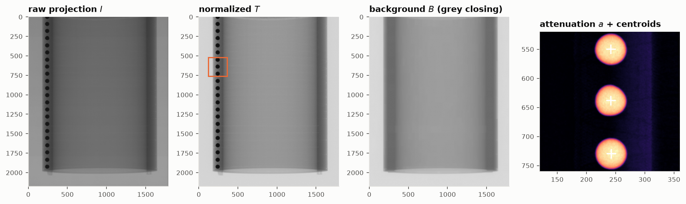
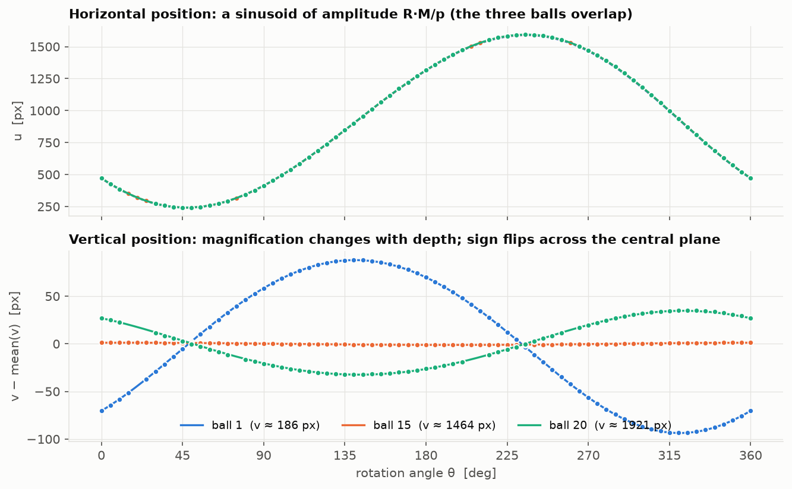
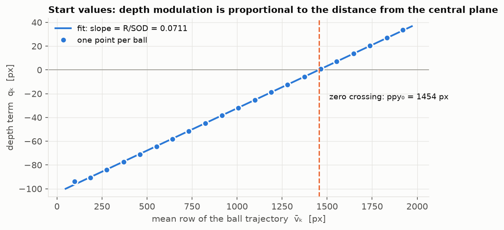
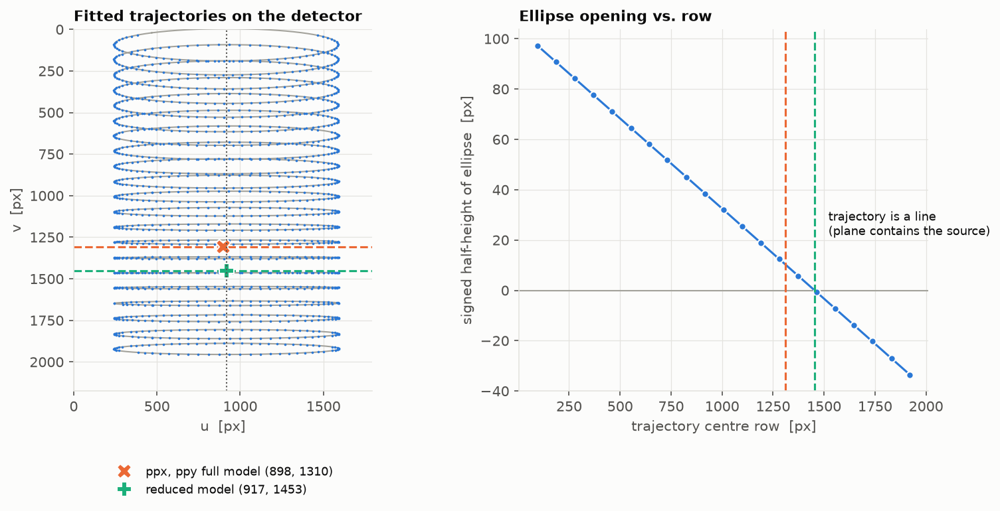
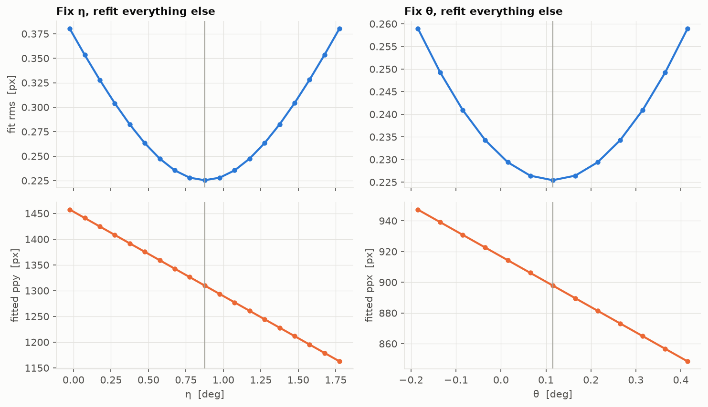
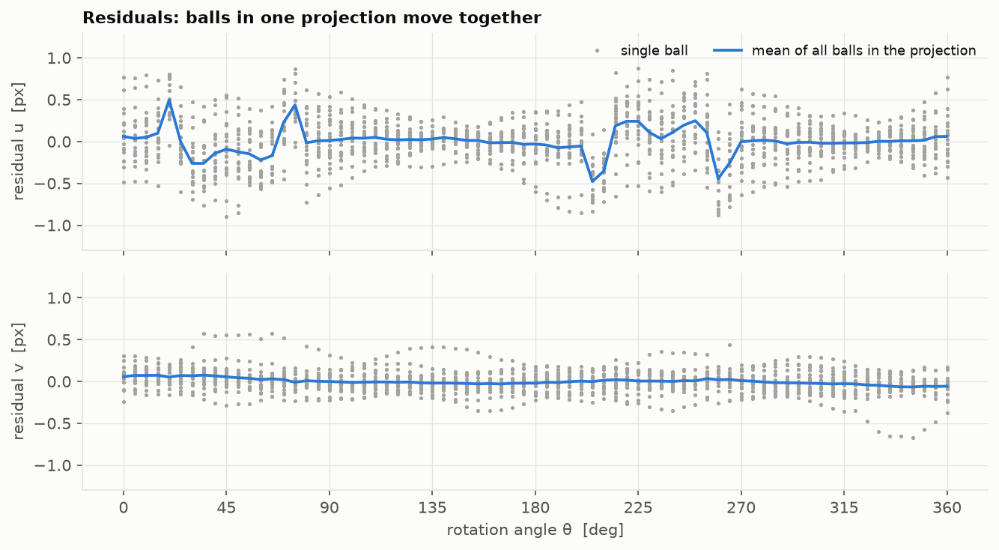
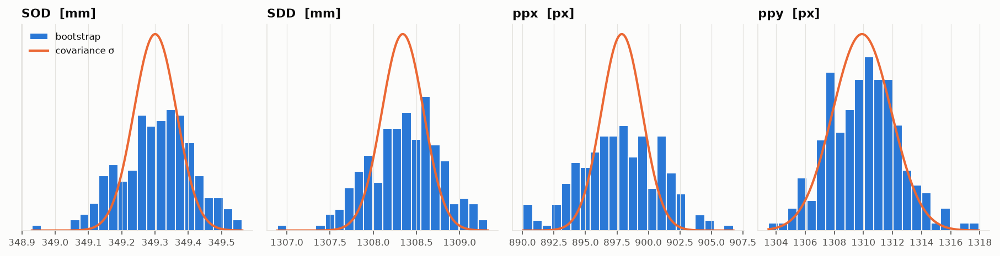

# How the cone-beam geometry is fitted

This note explains what [`xcal_geometry.py`](../xcal_geometry.py) does: from flat-field-corrected projections of 21 steel balls to SOD, SDD and the piercing point, with the equations it solves and the plots it is judged by. All figures use the real calibration data (`03_xcal`, 80 kV, 361 projections, every 5th projection used) and are made by [`make_figs.py`](make_figs.py).

## Relation to the literature

The script does not implement one published algorithm. It combines established pieces:

- **Phantom and geometry parametrization.** Balls on circles around the rotation axis, a source on a circular orbit and a detector with three tilt angles, as used by Noo et al. [1], Cho et al. [2] and Yang et al. [3]. The parameter set (SOD, SDD, piercing point, detector tilts η, θ, ψ) is the one discussed in the review by Ferrucci et al. [4].
- **Estimation strategy.** Noo et al. [1] fit an ellipse to each ball trajectory and compute the geometry analytically from the ellipse parameters; Cho et al. [2] and Yang et al. [3] also use closed-form relations. Here the analytical step is only used for the start values (section 4). The final estimate is a direct non-linear least-squares fit of the full projection model to all ball centroids at once, in the spirit of bundle adjustment. This avoids the intermediate ellipse fit and gives the parameter covariance directly.
- **Ball centres.** The attenuation-weighted centroid is not exactly the projection of the ball centre in a cone beam; Clackdoyle and Mennessier [5] show that both lie on the major axis of the projected ellipse. For 2 mm balls at 350 mm from the source the offset is of order $(r/\mathrm{SOD})^2 \approx 10^{-5}$ relative to the distance from the piercing point, far below 0.01 px, so the centroid is used directly.
- **Numerics and statistics.** Trust-region reflective least squares [6] as implemented in SciPy, covariance from the Jacobian [7], and a bootstrap that resamples whole projections, i.e. a cluster bootstrap [8, 9].
- **Reduced model.** The untilted geometry is the one assumed by FDK-type reconstruction [10].

## 1. Normalization and ball detection

Each projection $I$ is corrected with the median dark current $D$ and the median open beam $F$ (10 frames each). Pixels where $F-D$ is below half its median, or that are saturated, are marked bad (4388 px) and replaced by their nearest good neighbour.

$$
T = \frac{I - D}{F - D}, \qquad
B = \mathrm{closing}_{1.6\,d}(T), \qquad
a = -\ln\frac{T}{B}
$$

A grey-level morphological closing [11] with a window larger than the ball shadow ($d \approx 56$ px) removes the dark balls and keeps the container, so $B$ is the background without balls and $a$ is the attenuation of the balls alone. Pixels with $a > 0.5$ are labelled; blobs that are too small, too large, not round, or touching the detector edge are dropped. The ball centre is the attenuation-weighted centroid:

$$
u = \frac{\sum_j a_j\, x_j}{\sum_j a_j}, \qquad
v = \frac{\sum_j a_j\, y_j}{\sum_j a_j}
$$



*Projection 46 (45°). The background estimate keeps the container wall but not the balls. The zoom (orange box) shows the attenuation $a$ with the detected centroids. Balls are linked between projections by their row position, giving 21 tracks.*

## 2. The forward model

The world frame is fixed to the rotation axis (the $z$ axis, pointing up). The beam travels along $+y$ and the source sits at $S=(0,-\mathrm{SOD},0)$. Ball $k$ lies on a circle of radius $R = 25$ mm at height $z_k$ with phase $\varphi_k$. At stage angle $\theta_i$ its centre is

$$
X_{ik} =
\begin{pmatrix} R\cos(s\,\theta_i + \varphi_k) \\ R\sin(s\,\theta_i + \varphi_k) \\ z_k \end{pmatrix},
\qquad s = \pm 1 ,
$$

where $s$ is the rotation sense (the script tries both).

```
  top view, not to scale                               detector
                                                           |
  S * ------------------------ (o) axis ------------------ * ppx    central ray
                                ball on circle R           |
  |<---------- SOD ----------->|                           |
  |<------------------------- SDD ------------------------>|
```

The detector orientation is a rotation $\mathbf D = R_z(\theta)\,R_x(\eta)\,R_y(\psi)$ applied to the untilted frame. It gives the pixel directions and the plane normal; the piercing point $P$ lies a distance SDD along the normal:

$$
\mathbf e_u = \mathbf D\hat x, \quad
\mathbf e_v = -\mathbf D\hat z, \quad
\mathbf n = \mathbf D\hat y, \qquad
P = S + \mathrm{SDD}\;\mathbf n
$$

The ray from $S$ through $X$ meets the detector plane $(Y-P)\cdot\mathbf n = 0$, and the pixel coordinates follow with pixel pitch $p = 0.139$ mm:

$$
Y = S + \frac{\mathrm{SDD}}{(X-S)\cdot\mathbf n}\,(X-S), \qquad
\hat u = \mathrm{ppx} + \frac{(Y-P)\cdot\mathbf e_u}{p}, \qquad
\hat v = \mathrm{ppy} + \frac{(Y-P)\cdot\mathbf e_v}{p}
$$

$\eta$ tilts the detector about its rows (towards or away from the axis), $\theta$ turns it about the vertical (so the central ray misses the axis), and $\psi$ rotates it in its own plane (the axis appears tilted in the image). Without tilts the model reduces to the familiar magnification formulas:

$$
\hat u = \mathrm{ppx} + \frac{\mathrm{SDD}}{p}\,\frac{R\cos\alpha_{ik}}{\mathrm{SOD} + R\sin\alpha_{ik}}, \qquad
\hat v = \mathrm{ppy} - \frac{\mathrm{SDD}}{p}\,\frac{z_k}{\mathrm{SOD} + R\sin\alpha_{ik}}, \qquad
\alpha_{ik} = s\theta_i + \varphi_k
$$

## 3. What each parameter is measured by

The horizontal position swings with amplitude $\approx R\,M/p$ with $M = \mathrm{SDD}/\mathrm{SOD}$: this fixes the **magnification**. The vertical position of a ball above or below the central plane is scaled by $1/(\mathrm{SOD} + R\sin\alpha)$, so it varies by a relative amount $\approx R/\mathrm{SOD}$ as the ball moves towards and away from the source: this fixes **SOD**. Balls on opposite sides of the central plane vary in opposite phase.



*Three balls: top (blue), near the central plane (orange), bottom (green). Points are measured centroids, lines the fitted model.*

Two scale symmetries follow directly from the model and decide where the systematic errors go:

1. $(R,\ \mathrm{SOD},\ z_k) \to \lambda\,(R,\ \mathrm{SOD},\ z_k)$ leaves every $\hat u, \hat v$ unchanged. **SOD is only known as well as $R$.**
2. $(\mathrm{SDD},\ p) \to \lambda\,(\mathrm{SDD},\ p)$ leaves every $\hat u, \hat v$ unchanged. **SDD is only known as well as the pixel pitch.**

## 4. Start values

The non-linear fit needs a start point near the answer; the script gets one in closed form, in the spirit of the analytical methods [1–3]. Each track is fitted with a sinusoid by linear least squares,

$$
u_{ik} \approx c_k + A_k\cos\theta_i + B_k\sin\theta_i, \qquad
v_{ik} \approx \bar v_k + C_k\cos\theta_i + E_k\sin\theta_i .
$$

The vertical part in quadrature with the horizontal swing is the depth term $q_k = -C_k\sin\beta_k + E_k\cos\beta_k$, with $\beta_k = \mathrm{atan2}(B_k, A_k)$. Expanding $1/(\mathrm{SOD} + R\sin\alpha)$ to first order gives

$$
q_k \approx \frac{R}{\mathrm{SOD}}\,\bigl(\bar v_k - \mathrm{ppy}\bigr)
\quad\Rightarrow\quad
\mathrm{SOD}_0 = \frac{R}{|\text{slope}|}, \quad
\mathrm{ppy}_0 = \text{zero crossing}, \quad
\mathrm{SDD}_0 = \frac{\langle\sqrt{A_k^2 + B_k^2}\rangle\,p}{R}\,\mathrm{SOD}_0 .
$$



*One point per ball. The line gives SOD₀ = 351.5 mm, SDD₀ = 1318 mm, ppy₀ = 1454 px and ppx₀ = 916 px (mean of $c_k$), all tilts 0. Phases come from $\beta_k$, heights from $\bar v_k$.*

## 5. The least-squares problem

All observations are fitted at once. The unknowns are the 7 geometry parameters plus a height and a phase for each of the 21 balls, 49 in total, against 1513 ball positions (3026 residuals):

$$
\min_{\mathbf p}\; \sum_{i,k}
\Bigl[\bigl(u_{ik} - \hat u_{ik}(\mathbf p)\bigr)^2 + \bigl(v_{ik} - \hat v_{ik}(\mathbf p)\bigr)^2\Bigr],
\qquad
\mathbf p = (\mathrm{SOD}, \mathrm{SDD}, \mathrm{ppx}, \mathrm{ppy}, \eta, \theta, \psi,\ z_{1..K},\ \varphi_{1..K})
$$

It is solved with the trust-region reflective method [6] (`scipy.optimize.least_squares`, Jacobian-scaled). Both rotation senses are tried: the wrong one ends at 22.7 px rms, the right one ($s = -1$) at 0.25 px. Then outliers are removed three times: with $d$ the residual distance of a point, the per-axis noise is $\sigma = \mathrm{median}(d)/1.1774$ (the median of a Rayleigh distribution) and points with $d > 5\sigma$ are dropped. This removes 35 of 1513 points; the final rms is 0.29 px in $u$ and 0.13 px in $v$.



*Left: every ball traces an ellipse on the detector; dots are measurements, grey lines the model, the dotted line the image of the rotation axis (COR = 916.8 px). Right: the ellipse opens one way above and the other way below the row where the ball plane contains the source (green, 1453 px), the property the ellipse method of Noo et al. [1] is built on. The full-model piercing point (orange, 1310 px) lies elsewhere because the detector is tilted.*

## 6. Tilt and piercing point trade off

What the balls pin down sharply is where the ray *perpendicular to the rotation axis* hits the detector: the degenerate row and the axis image. The piercing point is the foot of the perpendicular *to the detector*. The two coincide only for an untilted detector. A tilt moves the piercing point by

$$
\Delta\mathrm{ppy} \approx \frac{\mathrm{SDD}\tan\eta}{p}
= \frac{1308.3\ \text{mm}\cdot\tan 0.875^\circ}{0.139\ \text{mm}} = 143.8\ \text{px},
\qquad
\Delta\mathrm{ppx} \approx \frac{\mathrm{SDD}\tan\theta}{p} = 18.9\ \text{px}.
$$

These match the observed differences, 1453.4 − 1309.9 = 143.5 px and COR − ppx = 18.9 px. The tilts are only seen through the small perspective change they cause across the field of view, so the fit is a long, shallow valley: the correlation between $\eta$ and ppy is −0.998, between $\theta$ and ppx −1.000. The weak sensitivity of the out-of-plane detector tilts is a known property of ball-phantom calibration [1, 4].



*Profile fits: one tilt fixed at a time, the other 48 parameters refitted. Setting $\eta = 0$ raises the rms from 0.225 to 0.38 px and moves ppy to 1457 px. The minimum is clear, so the tilts are measured, but every 0.1° of either tilt moves the piercing point by about 16 px ($\mathrm{SDD}/p$ per radian).*

> **Which numbers to use.** The script reports two fits. The **full model** has all tilts free. The **reduced model** fixes $\eta = \theta = 0$, so the piercing point equals the degenerate row and the axis image (ppx = COR). Use the reduced model for a reconstructor that assumes an untilted detector, such as FDK [10]; use the full model only if your reconstructor accepts detector tilts.

## 7. Uncertainty

### Covariance of the fit

Near the minimum the residuals are linear in the parameters, $\mathbf r(\mathbf p + \delta) \approx \mathbf r + \mathbf J\delta$. With $N = 2956$ residuals and $P = 49$ parameters the parameter covariance is [7]

$$
\mathbf C = s^2\,(\mathbf J^\top \mathbf J)^{-1}, \qquad
s^2 = \frac{\lVert \mathbf r \rVert^2}{N - P}, \qquad
\sigma_{\mathrm{cov},j} = \sqrt{C_{jj}}, \qquad
\rho_{jl} = \frac{C_{jl}}{\sigma_j \sigma_l}.
$$

This assumes independent residuals. They are not: all balls in a projection shift together, which looks like jitter in the stage angle or wobble of the axis. The frame-to-frame scatter of the mean $u$ residual is 0.15 px, against 0.25 px for the scatter within a frame.



*Residuals of the full model. Grey points are single balls; the blue line is the mean over all balls in a projection. The common shifts in $u$ (near 20°, 75°, 205°, 260°) are not explained by any static geometry.*

### Bootstrap over projections

To include that correlation, whole projections are resampled with replacement and the fit is repeated $B = 200$ times from the best solution [8]. Resampling the clusters (projections) instead of single points keeps the within-projection correlation intact [9]. The standard deviation of the results is $\sigma_{\mathrm{boot}}$; for ppx it is twice the covariance value.



*200 bootstrap fits (bars) against the normal distribution implied by the covariance (line). Where the bars are wider, the residual correlation matters.*

### Systematics and the total

Because of the scale symmetries, the ball radius and the pixel pitch enter directly. Their effect is found by refitting with the input shifted by its tolerance:

$$
\sigma_{\mathrm{sys},j} =
\tfrac12\bigl|\,p_j(R + \delta R) - p_j(R - \delta R)\,\bigr|
\;\oplus\;
\tfrac12\bigl|\,p_j(p + \delta p) - p_j(p - \delta p)\,\bigr|,
\qquad
\sigma_{\mathrm{tot}} = \sqrt{\max(\sigma_{\mathrm{cov}}, \sigma_{\mathrm{boot}})^2 + \sigma_{\mathrm{sys}}^2}
$$

With the default $\delta R = 0.01$ mm this adds $\mathrm{SOD}\cdot\delta R/R = 0.14$ mm to SOD and nothing to SDD. The pixel-pitch tolerance is 0 by default (`--pixel-tol`).

## 8. Result

Every 5th projection, $\delta R = 0.01$ mm. Full model with 200 bootstrap repeats, reduced model with 100.

| Parameter | Full model | σ_cov | σ_boot | σ_total | Reduced model | σ_total |
|---|---:|---:|---:|---:|---:|---:|
| SOD [mm] | 349.30 | 0.06 | 0.11 | 0.18 | 349.72 | 0.19 |
| SDD [mm] | 1308.34 | 0.24 | 0.41 | 0.41 | 1308.90 | 0.45 |
| ppx [px] | 897.9 | 1.6 | 3.2 | 3.2 | 917.05 | 0.03 |
| ppy [px] | 1309.9 | 2.0 | 2.5 | 2.5 | 1453.4 | 0.2 |
| η [deg] | 0.875 | 0.012 | 0.015 | 0.015 | 0 (fixed) | – |
| θ [deg] | 0.115 | 0.010 | 0.019 | 0.019 | 0 (fixed) | – |
| ψ [deg] | 0.0772 | 0.0006 | 0.0009 | 0.0009 | 0.0811 | 0.0022 |
| COR [px] | 916.8 | | | | 917.05 | |

Magnification SDD/SOD = 3.746, effective pixel size 37.1 µm. Pixel coordinates are 0-based (column, row) of the image array as read from the FITS files.

## 9. Less precise phantoms: per-ball radii and the scale from the ball size

The second data set (`P20261108/…/01_xcal`, 10 balls of 1 mm, nominal circle radius 5 mm) showed two problems that the 25 mm phantom hid.

**Balls are not all at the same radius.** With one common $R$ the $u$ residual of each ball is a sinusoid in phase with its own swing, with amplitudes from −6 to +4.5 px (rms 2.7 px). That is a radius error of about ±1 % per ball. The script therefore fits one radius per ball (`--radii per-ball`, the default),

$$
R_k = R + (\mathbf Q\,\mathbf w)_k ,
$$

where the columns of $\mathbf Q$ are orthonormal to a constant (so $\langle R_k\rangle = R$ keeps setting the scale) and, in the full model, also to the ball height. A linear trend of the radius with height, i.e. a ball column leaning radially, changes the magnification linearly with the row, exactly like the detector tilt $\eta$; the two cannot be separated from ball positions. The full model therefore attributes such a trend to $\eta$; the reduced model ($\eta = 0$) attributes it to a lean of the column. On the 1 mm phantom this is a choice between a 3.6° detector tilt and a 0.25° lean of the column: both fit the data (rms 0.16 vs 0.18 px), and ppy differs by $\mathrm{SDD}\tan\eta/p = 587$ px between them.

**Checking the scale with the ball size.** Section 3 showed that only the product of $R$ and $1/\mathrm{SOD}$ is measured. The ball diameter $D$ gives an independent scale: a ball at depth $L_{ik} = (X_{ik}-S)\cdot\mathbf n$ casts a shadow of diameter

$$
d_{ik} = \frac{D\,\mathrm{SDD}}{p\,L_{ik}} ,
\qquad
\lambda = \Bigl\langle \operatorname*{median}_i \frac{d^{\text{meas}}_{ik}}{d_{ik}} \Bigr\rangle_k ,
\qquad
R_{\text{ball}} = \frac{R}{\lambda} .
$$

The measured diameter comes from a least-squares fit of a blurred sphere shadow to the radial transmission profile of each ball,

$$
t(r) = G_\sigma * \Bigl[\, b\,\exp\!\bigl(-\mu\,c(r)^{\gamma}\bigr)\Bigr], \qquad c(r) = 2\sqrt{\max(r_0^2 - r^2,\,0)} ,
$$

with radius $r_0$, attenuation $\mu$, an exponent $\gamma$ that absorbs beam hardening, blur $\sigma$ and background $b$. A simpler rule (steepest point of the edge) reads 1.5–2.5 % small, because the edge of a sphere is not symmetric and blur moves its steepest point inwards. On synthetic balls the fit is within 0.3 %; on the 25 mm phantom it gives $R_{\text{ball}} = 25.03 \pm 0.07$ mm against the nominal 25.0 mm.

The scale check is always reported. With `--scale ball` the script uses $R_{\text{ball}}$ instead of the nominal radius; its uncertainty (scatter between balls and `--ball-diameter-tol`, default 0.005 mm) enters $\sigma_{\text{sys}}$ of SOD. For the 1 mm phantom the balls imply $R = 8.01 \pm 0.05$ mm, not 5 mm, and

| | Full model | Reduced model |
|---|---:|---:|
| SOD [mm] | 112.01 ± 0.63 | 112.34 ± 0.64 |
| SDD [mm] | 1307.40 ± 0.35 | 1310.06 ± 0.44 |
| ppx [px] | 894.0 ± 1.7 | 920.20 ± 0.02 |
| ppy [px] | 880.1 ± 1.5 | 1466.8 ± 0.2 |
| η [deg] | 3.570 ± 0.009 | 0 (fixed) |
| M = SDD/SOD | 11.67 | 11.66 |

SDD does not depend on the scale and agrees with the 25 mm phantom (1308.6 mm). Since SOD scales with $D$, the magnification scales with $1/D$: an expected $M = 11.8$ would need balls of 0.989 mm.

## References

1. F. Noo, R. Clackdoyle, C. Mennessier, T. A. White, T. J. Roney, "Analytic method based on identification of ellipse parameters for scanner calibration in cone-beam tomography," *Phys. Med. Biol.* **45**(11), 3489–3508 (2000).
2. Y. Cho, D. J. Moseley, J. H. Siewerdsen, D. A. Jaffray, "Accurate technique for complete geometric calibration of cone-beam computed tomography systems," *Med. Phys.* **32**(4), 968–983 (2005). doi:[10.1118/1.1869652](https://doi.org/10.1118/1.1869652)
3. K. Yang, A. L. C. Kwan, D. F. Miller, J. M. Boone, "A geometric calibration method for cone beam CT systems," *Med. Phys.* **33**(6), 1695–1706 (2006). doi:[10.1118/1.2198187](https://doi.org/10.1118/1.2198187)
4. M. Ferrucci, R. K. Leach, C. Giusca, S. Carmignato, W. Dewulf, "Towards geometrical calibration of x-ray computed tomography systems—a review," *Meas. Sci. Technol.* **26**, 092003 (2015). doi:[10.1088/0957-0233/26/9/092003](https://doi.org/10.1088/0957-0233/26/9/092003)
5. R. Clackdoyle, C. Mennessier, "Centers and centroids of the cone-beam projection of a ball," *Phys. Med. Biol.* **56**(23), 7371–7391 (2011). doi:[10.1088/0031-9155/56/23/003](https://doi.org/10.1088/0031-9155/56/23/003)
6. M. A. Branch, T. F. Coleman, Y. Li, "A subspace, interior, and conjugate gradient method for large-scale bound-constrained minimization problems," *SIAM J. Sci. Comput.* **21**(1), 1–23 (1999). doi:[10.1137/S1064827595289108](https://doi.org/10.1137/S1064827595289108)
7. W. H. Press, S. A. Teukolsky, W. T. Vetterling, B. P. Flannery, *Numerical Recipes: The Art of Scientific Computing*, 3rd ed., Cambridge University Press (2007), ch. 15 (modeling of data).
8. B. Efron, R. J. Tibshirani, *An Introduction to the Bootstrap*, Chapman & Hall (1993).
9. A. C. Davison, D. V. Hinkley, *Bootstrap Methods and Their Application*, Cambridge University Press (1997), sec. 3.8 (hierarchical data).
10. L. A. Feldkamp, L. C. Davis, J. W. Kress, "Practical cone-beam algorithm," *J. Opt. Soc. Am. A* **1**(6), 612–619 (1984). doi:[10.1364/JOSAA.1.000612](https://doi.org/10.1364/JOSAA.1.000612)
11. P. Soille, *Morphological Image Analysis: Principles and Applications*, 2nd ed., Springer (2003).
